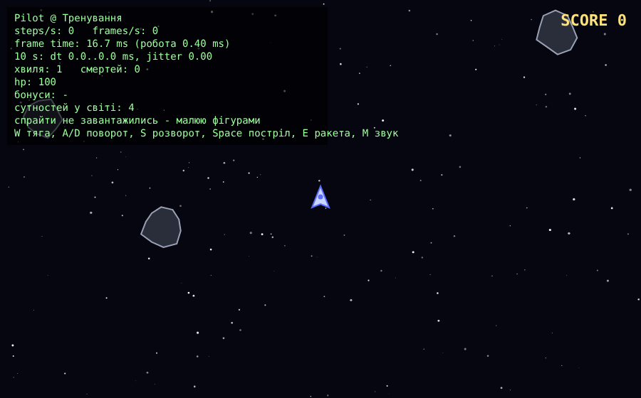

# Space Duel

Браузерна гра про космічні кораблі (курс JavaScript, лаби по тегах `lab-01`, `lab-02`, ...).

## Запуск

```bash
npm install
npm run dev
```

Лінтер і форматування: `npm run lint`, `npm run format:check`.

Керування: `W`/`↑` тяга, `A`/`D` або `←`/`→` поворот, `S`/`↓` розворот на 180°, `Space` постріл, `E` самонавідна ракета, `M` звук, `R` повернути корабель у центр, `Esc` під час завантаження — скасувати.

Параметри в адресі:

- `/?exp=1`, `/?exp=2`, `/?exp=3` — експерименти лаби 1
- `/?bug=this` — наївний слухач клавіатури з лаби 2 (постріл не працює)
- `/?seq=1`, `/?delay=200` — послідовне завантаження і штучна затримка (лаба 3)
- `/?fail=404`, `timeout`, `abort`, `json`, `flaky`, `lobby` — симуляція збоїв (лаба 3)

## Лаба 3: асинхронний JavaScript

### Що де

- `public/assets/manifest.json` — що завантажувати: спрайтшит, 5 звуків, `arena.json`
- `src/assets/loader.js` — `fetchJson` (перевіряє `response.ok`), `loadJson`, `loadImage`, `loadAudio`, `withRetry`, `loadAll`. Усі приймають `signal`
- `src/audio.js` — `AudioContext`, вмикається після першого кліку або клавіші; звуки декодуються ще під час завантаження
- `src/hud.js` — рахунок і написи `+100`
- `src/lobby/lobby.js` — `class Lobby extends EventTarget` (`start`, `refresh`, `join`, `stop`); `src/lobby/lobbyView.js` — тільки DOM
- `public/api/rooms.json` — список кімнат (у лабі 4 буде справжній сервер)
- `server/devMiddleware.js` — middleware для Vite: `?delay=мс` і `?flaky=N` (перші N запитів отримують 503)

Порядок у `main.js`: екран завантаження з прогрес-баром → `await loadAll(...)` → лобі → гравець натискає Join → гра. Кнопку Join чекаємо як проміс: `new Promise(resolve => lobby.addEventListener('join', ..., { once: true }))`.

**Повтори.** `withRetry` робить до 3 спроб, пауза `200 · 2^(n-1)` мс плюс випадкові 0–200 мс (jitter). Повторює лише 5xx, таймаут і помилку мережі. 4xx, битий JSON і скасування гравцем не повторює, бо повтор не допоможе. Кожна спроба має свій таймаут `AbortSignal.timeout`, об'єднаний із загальним сигналом через `AbortSignal.any`.

**Прогрес.** Кожен файл у `loadAll` обгорнутий у `.then`/`.catch`, який збільшує лічильник і викликає `onProgress(done, total)`. Тому смужка рухається по мірі готовності файлів, а не одразу на 100%.

**Необов'язкові файли.** Спрайтшит і звуки позначені `optional`: якщо вони не завантажились, гра стартує з фігурами замість спрайтів або без звуку. `arena.json` обов'язковий: без нього показується кнопка Retry.

**Події замість імпортів.** `World extends EventTarget` і в потрібних місцях робить `dispatchEvent(new CustomEvent(...))`: `fired`, `hit`, `exploded`, `pickup`, `score`. У папці `src/sim/` немає жодного імпорту `audio.js` чи `hud.js`, вони самі підписуються на події світу в `game.js`.

**Лобі.** `refresh()` викликається одразу і далі кожні 3 с через `setInterval`. Кожен запит має `AbortSignal.timeout(2000)`, а сигнал контролера лобі скасовує все, щойно гравець натиснув Join (`stop()` → `abort()`), тож запити не висять у фоні.

**Спрайти.** `public/assets/sprites.png` — один рядок кадрів 64×64 (корабель, корабель з вогнем, куля, ракета, астероїди, мисливці, бонуси). Малюються через `drawImage(img, sx, 0, 64, 64, ...)`, де `sx = номер_кадру * 64`.

### Sequential vs concurrent

Заміряв `performance.now()` усередині `loadAll` (7 файлів: arena.json, sprites.png, 5 wav, разом із декодуванням звуку). Headless Chrome, локальний сервер з тим самим middleware, по 3 запуски:

| Режим                        | Без затримки | `?delay=200` (кожна відповідь +200 мс) |
| ---------------------------- | ------------ | -------------------------------------- |
| concurrent (`Promise.all`)   | 26–28 мс     | 415–420 мс                             |
| sequential (`for` + `await`) | 30–35 мс     | 1447–1448 мс                           |

Без затримки різниця маленька, бо локально файли віддаються майже миттєво. Із затримкою послідовне завантаження — це сума: 7 × 200 = 1400 мс + декодування. Паралельне мало б дати ~200 мс, а вийшло ~415. Так вийшло через те, що браузер по HTTP/1.1 тримає максимум 6 з'єднань на один сервер: 6 файлів ідуть разом, а сьомий чекає, тобто 2 × 200 мс. Все одно паралельне завантаження у 3.5 раза швидше.

### П'ять головоломок порядку

Перевірено в Chrome (кожну запускав 10 разів, вивід нижче — реальний).

**1. await**

```js
console.log('A');
async function f() {
  console.log('B');
  await null;
  console.log('C');
}
f();
Promise.resolve().then(() => console.log('D'));
console.log('E');
```

Вивід: `A B E C D`. До першого `await` функція виконується синхронно (B), продовження після `await` стає мікрозадачею раніше, ніж `.then` з D.

**2. setTimeout всередині .then**

```js
setTimeout(() => console.log('1'), 0);
Promise.resolve().then(() => {
  console.log('2');
  setTimeout(() => console.log('3'), 0);
});
queueMicrotask(() => console.log('4'));
console.log('5');
```

Вивід: `5 2 4 1 3`. Спочатку синхронний код, потім усі мікрозадачі (2, 4), потім задачі-таймери по черзі: таймер 1 поставлений раніше за таймер 3.

**3. requestAnimationFrame**

```js
requestAnimationFrame(() => {
  console.log('raf');
  Promise.resolve().then(() => console.log('raf-micro'));
});
setTimeout(() => console.log('timeout'), 0);
Promise.resolve().then(() => console.log('micro'));
console.log('sync');
```

Вивід: `sync micro timeout raf raf-micro`, але іноді `sync micro raf raf-micro timeout`. rAF — не задача і не мікрозадача, він виконується перед малюванням кадру, а коли буде кадр, залежить від того, де ми в циклі монітора. Стабільно одне: `raf-micro` завжди одразу після `raf`, бо мікрозадачі вичерпуються після кожного колбека.

**4. Повернути проміс з .then**

```js
Promise.resolve()
  .then(() => {
    console.log('a1');
    return Promise.resolve();
  })
  .then(() => console.log('a2'));
Promise.resolve()
  .then(() => console.log('b1'))
  .then(() => console.log('b2'))
  .then(() => console.log('b3'))
  .then(() => console.log('b4'));
```

Вивід: `a1 b1 b2 b3 a2 b4`. Якщо `.then` повертає проміс, наступний `.then` чекає, поки цей проміс "розпакується", а це +2 мікрозадачі. Тому a2 відстає від b2 на два кроки.

**5. Помилка, catch, finally**

```js
async function load() {
  console.log('L1');
  throw new Error('x');
}
load()
  .catch(() => console.log('L2'))
  .finally(() => console.log('L3'));
setTimeout(() => console.log('L4'));
(async () => {
  console.log('L5');
  await undefined;
  console.log('L6');
})();
console.log('L7');
```

Вивід: `L1 L5 L7 L2 L6 L3 L4`. `throw` в async-функції не ламає код одразу, а робить проміс rejected. `catch` (L2) і продовження IIFE (L6) — дві мікрозадачі в черзі. `finally` ставиться в чергу тільки після L2, тому L3 після L6. Таймер L4 — останній.

### Галерея збоїв

| Збій                | Як відтворити                                                                       | Що відбувається                                                                                                                                                                |
| ------------------- | ----------------------------------------------------------------------------------- | ------------------------------------------------------------------------------------------------------------------------------------------------------------------------------ |
| 404 спрайтшита      | `?fail=404`                                                                         | `HttpError 404`, без повторів (4xx). Спрайти необов'язкові, тому гра стартує і малює кораблі фігурами, на HUD напис про це. В консолі `[loader] sprites пропущено: HTTP 404`   |
| Таймаут мережі      | `?fail=timeout` (arena.json відповідає за 3 с, таймаут 1 с)                         | 3 спроби з паузами (в консолі `[retry] спроба 1 невдала (signal timed out), ще раз через 217 мс` і т.д.), потім `TimeoutError` і кнопка Retry                                  |
| Abort посередині    | `?fail=abort` (усе повільне, через 0.5 с `abort()`), або `Esc` під час завантаження | усі файли отримують `AbortError`, повторів немає, кнопка Retry                                                                                                                 |
| Битий JSON          | `?fail=json` (`broken.json` обрізаний)                                              | `SyntaxError: Unexpected end of JSON input`, без повторів. Інші файли, що ще качались, скасовуються (`Promise.all` сам їх не зупиняє, тому `controller.abort()`), кнопка Retry |
| Нестабільний сервер | `?fail=flaky`                                                                       | два рази 503, ретраї з backoff, на третій раз успіх, гра стартує (~820 мс замість ~25)                                                                                         |
| Таймаут лобі        | `?fail=lobby`                                                                       | у лобі червоний напис `Не вдалося оновити список: signal timed out`, лобі пробує знову кожні 3 с                                                                               |

Retry у демо запускає завантаження ще раз уже без симуляції збою, тож друга спроба проходить і з'являється лобі.

Скріншоти: `docs/failures/404-sprite.png`, `timeout.png`, `abort.png`, `bad-json.png`, `lobby-timeout.png`.




## Лаба 2: об'єкти, класи і this

### Структура

- `src/sim/vector.js` — `Vector2`, усі методи повертають новий вектор (`add`, `sub`, `scale`, `length`, `normalize`, `rotate`, `dot`, `fromAngle`)
- `src/sim/entity.js` — `Entity`: `id` (приватний `#id` зі статичного лічильника `static #nextId`), `pos`, `vel`, `angle`, `radius`, `kind`, `alive`, `update(dt)`
- `Ship`, `Bullet`, `Asteroid`, `Pickup`, `Explosion` — кожен `extends Entity`, глибше нікого немає
- `src/sim/world.js` — `World` поверх `Map<id, Entity>`: `spawn`, `despawn` (лише позначка, видалення в `#sweep()` в кінці кроку), `get`, `[Symbol.iterator]`, генератор `*ofKind(kind)`, `step(dt, inputs)`
- `src/sim/collision.js` — `findCollisions(world)`: коло-коло, кожен з кожним, повертає пари `[a, b]`
- `src/sim/rules.js` — що робити з парою: куля б'є астероїд або чужий корабель, корабель врізається в астероїд, корабель підбирає бонус
- `src/sim/components/homing.js` — компонент самонаведення і `homingSystem`

Порядок кроку в `World.step`: зберегти попередні позиції → роздати кораблям керування → самонаведення → `update` усіх → загорнути позиції → зіткнення → нові астероїди і бонуси → `#sweep()`.

Нові сутності, створені під час кроку (кулі, уламки, вибухи), теж додаються в Map тільки в `#sweep()`. Інакше `for...of` по Map пройшов би і по них у тому ж кроці.

У корабля приватне `#hp`, ззовні є лише `get hp()`. Спроба `ship.hp = 5` у модулі кидає `TypeError`, бо сетера немає. Здоров'я змінюється тільки через `takeDamage()`. Після знищення корабель 2 с чекає, з'являється у вільному місці з 2 с щита. Рахунок, хвиля, hp і бонуси видно на HUD.

### Баг з this

Постріл зроблений методом `Ship.fire()`, який ставить `this.shotQueued = true`, а куля створюється в `update()`. Спочатку слухач був підключений так (зараз цей варіант вмикається через `?bug=this`):

```js
window.addEventListener('keydown', ship.fire);
```

`this` залежить від того, як функцію викликали, а не де її оголосили. Правила від сильнішого: `new` → новий об'єкт; `call`/`apply`/`bind` → переданий об'єкт; `obj.f()` → `obj`; звичайний `f()` → `undefined` (у модулях і класах завжди strict mode). Стрілки свого `this` не мають.

Помилки в консолі немає, але корабель не стріляє. `addEventListener` отримує саму функцію без об'єкта, а браузер викликає слухача з `this` = елемент, на якому висить слухач, тобто `window`. У підсумку записується `window.shotQueued = true` (у консолі видно `window.shotQueued === true`). Якщо так само викликати `const f = ship.fire; f()`, у модулі буде default binding, `this === undefined` і `TypeError`.

Що вибрав: стрілка-обгортка.

```js
window.addEventListener('keydown', (event) => {
  if (event.code === 'Space') ship.fire();
});
```

Тут `ship.fire()` викликається через крапку (implicit binding), тож `this === ship`. До того ж все одно треба перевіряти, яка це клавіша.

Інші варіанти:

- `ship.fire.bind(ship)` — нова функція з назавжди прив'язаним `this`. Мінус: щоб потім зробити `removeEventListener`, результат `bind` треба зберегти в змінну, бо кожен `bind` повертає нову функцію.
- поле-стрілка в класі `fire = () => { this.shotQueued = true; }` — `this` прив'язаний одразу при створенні. Мінус: функція створюється окремо для кожного корабля, а не одна на `Ship.prototype`, і її не можна нормально перевизначити через `super.fire()`.

### Композиція: homing і pickup

Якби робили все наслідуванням, вийшло б приблизно так:

```text
Entity
├── MovingEntity
│   ├── Ship
│   ├── Bullet
│   │   └── HomingBullet
│   └── Asteroid
│       └── HomingAsteroid
└── StaticEntity
    └── Pickup
        ├── ShieldPickup
        └── TriplePickup
```

Проблеми: логіка наведення потрібна і кулі, і астероїду, а вони в різних гілках, тому її довелося б копіювати або піднімати в `MovingEntity`, де вона більшості не потрібна. Кожна нова комбінація ("самонавідний бонус", "астероїд, який стріляє") означає новий клас. Дерево стає глибоким, а зміна в середньому класі зачіпає всіх нащадків.

Як зроблено в мене (явні поля-компоненти, варіант "explicit component fields"):

- **homing** — це просто дані `{ targetKind, turnRate, range }`, які можна покласти в поле будь-якої сутності. Ракета — це звичайний `Bullet`, якому зробили `missile.homing = makeHoming('asteroid', 4, 500)`. Астероїд-мисливець — звичайний `Asteroid` з `homing = makeHoming('ship', 0.8, 400)`. Повертає їх одна функція `homingSystem(world, dt)`, яка перевіряє лише `if (entity.homing)`, і їй неважливо, куля це чи астероїд.
- **pickup** — `Pickup extends Entity` без швидкості, але з компонентом-даними `pickup = { effect, duration }`. Правило зіткнень перевіряє `if (thing.pickup)`, а не клас, а корабель просто кладе ефект собі в `effects`. Новий бонус — це нове значення `effect`, а не новий клас.

Що вийшло: наслідування лише один рівень (`Entity` → конкретна сутність), а поведінки додаються полями. Мінус: системи мають самі перевіряти, чи є в сутності потрібне поле, і з тексту класу не видно, що в нього може з'явитись `homing`.

### Експерименти в консолі

| Код                                                         | Результат           | Чому                                                                                                         |
| ----------------------------------------------------------- | ------------------- | ------------------------------------------------------------------------------------------------------------ |
| `b = Object.create(a); a.hello = 'changed'; b.hello`        | `'changed'`         | у `b` немає свого `hello`, пошук іде по прототипу в `a`                                                      |
| `const m = a.m; m()` для `class A { m() { return this; } }` | `undefined`         | виклик без об'єкта, а класи завжди в strict mode. `m.call(a)` повертає `a`. Це той самий баг, що зі слухачем |
| `{ '1': 'x' }[1]` проти `new Map([[1, 'x']]).get('1')`      | `'x'` і `undefined` | ключі звичайного об'єкта завжди рядки, тому `1` стає `'1'`. Map порівнює ключі як є, а `1 !== '1'`           |

## Лаба 1: Event Loop і ігровий цикл

### Структура

- `src/loop.js` — `createLoop({ step, simulate, render })`: rAF, акумулятор, обмеження dt до 0.25 с, статистика для HUD
- `src/input.js` — `createInput(target)`: замикання зі станом клавіш, `isDown` і `justPressed`
- `src/sim/ship.js` — `integrate(ship, input, dt)`: повертає новий стан, без DOM (у лабі 2 її викликає `Ship.update`)
- `src/sim/arena.js` — загортання країв
- `src/render/canvas.js` — canvas з урахуванням `devicePixelRatio`
- `src/render/draw.js` — зірки, корабель, HUD, інтерполяція (з урахуванням переходу кута через ±π і переходу через край арени)

`justPressed` зроблений через лічильник натискань: на `keydown` лічильник збільшується, а в кінці кожного кроку запам'ятовується його значення. Якщо лічильник змінився з минулого кроку, було нове натискання. Так натискання не губиться, навіть якщо клавішу відпустили раніше, ніж відбувся крок.

### Налаштування фізики

| Параметр      | Значення  | Чому                                                                                                                     |
| ------------- | --------- | ------------------------------------------------------------------------------------------------------------------------ |
| `turnSpeed`   | 3.5 рад/с | повний оберт приблизно за 1.8 с; швидше важко прицілитись, повільніше корабель здається важким                           |
| `thrustPower` | 260 px/с² | до ~200 px/с розганяється приблизно за секунду                                                                           |
| `drag`        | 0.5 1/с   | при 0 корабель ніколи не зупиняється, при великому значенні не відчувається космос                                       |
| `maxSpeed`    | 380 px/с  | без обмеження швидкість росла б до 520 px/с (тяга / опір), і корабель перелітав би екран швидше, ніж встигаєш зреагувати |

Опір зроблений як `v *= Math.exp(-drag * dt)`. Так гальмування правильно масштабується від `dt`, на відміну від `v *= 0.99` за кадр.

### Експерименти

Монітор 144 Гц, Chrome. Звичайний режим: steps/s = 60, frames/s = 143, frame time = 7.0 ms (сам кадр рахується 0.2 ms).

#### 1. Блокування 100 мс кожен 60-й кадр (`?exp=1`)

Результат: frames/s ≈ 116 (було 143), максимальний dt за 10 с ≈ 107 ms, steps/s = 60.

Гравець бачить регулярні фризи: приблизно двічі на секунду картинка зупиняється на 0.1 с, потім корабель стрибає вперед. Steps/s залишається 60, бо після фризу акумулятор отримує ~0.1 с і за один кадр робить ~6 кроків симуляції.

Чому це не обійти з JS у тому ж потоці: JS однопотоковий, і функція виконується до кінця (run-to-completion). Поки `while` крутиться в call stack, event loop не може взяти наступну задачу, обробити keydown, виконати мікрозадачі чи дійти до кроку рендеру (style/layout/paint). `setTimeout`, проміси та інші обробники лише стають у чергу і чекають, тому перервати синхронний цикл вони не можуть. Допомогти може тільки інший потік (Web Worker) або менше роботи за кадр.

#### 2. `setInterval(frame, 16)` замість rAF (`?exp=2`)

|                                   | rAF                                                 | setInterval                            |
| --------------------------------- | --------------------------------------------------- | -------------------------------------- |
| frames/s                          | 143                                                 | ≈ 62                                   |
| dt min..max за 10 с, ms           | 5.9..20.7                                           | ≈ 14..19                               |
| jitter (станд. відхилення dt), ms | 0.59                                                | ≈ 1.2                                  |
| 5 с у фоновій вкладці             | кадрів немає взагалі, після повернення dt ≈ 5000 ms | ≈ 1 кадр/с, dt ≈ 1000 ms, steps/s ≈ 15 |

Висновки: `setInterval` ставить задачу в task queue приблизно раз на 16 мс, але ніяк не прив'язаний до оновлення екрана. Тому частота ~62 fps навіть на моніторі 144 Гц, кадри то пропускаються, то малюються двічі за одне оновлення, і dt «стрибає». rAF викликається рівно один раз перед кожним малюванням. У фоновій вкладці rAF повністю зупиняється, а `setInterval` продовжує працювати, але браузер обмежує його до ~1 разу на секунду. Через обмеження dt до 0.25 с за такий тік робиться лише 15 кроків, тому steps/s падає до ~15. Ще одна причина: 16 мс ≠ 16.67 мс.

#### 3. Змінний крок замість фіксованого (`?exp=3`)

Тест: натиснути `R`, потім тримати `W` 5 секунд (у лабі 2 на арені вже є астероїди, тому заміри зручніше робити на тезі `lab-01`). HUD показує «шлях за 5 с».

Ті самі розрахунки без браузера (`npm run exp3`, та сама `integrate()`):

| Частота кадрів   | Змінний крок, px | Фіксований крок, px |
| ---------------- | ---------------- | ------------------- |
| 60 Гц            | 1508.04          | 1508.04             |
| 144 Гц           | 1507.68          | 1508.04             |
| ~10 fps (CPU 6×) | 1510.51          | 1508.04             |

У браузері (DevTools → Performance → CPU 6× slowdown):

|                              | Без тротлінгу | CPU 6×   |
| ---------------------------- | ------------- | -------- |
| `?exp=3` (змінний крок)      | ≈ 1507.7      | ≈ 1508.9 |
| звичайний режим (фіксований) | 1508.04       | 1508.04  |

Пояснення: інтегрування йде дискретними кроками, і результат залежить від розміру кроку. Якщо крок = час кадру, то на різних комп'ютерах і при різному навантаженні корабель опиняється в різних місцях. З фіксованим кроком завжди виконується 300 однакових кроків по 1/60 с, тому результат однаковий до сотих. Для мультиплеєра (лаба 5) це обов'язково: клієнт і сервер мають рахувати однаково.
