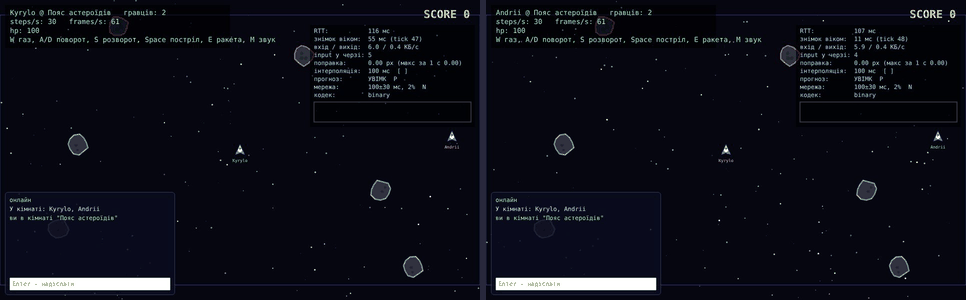
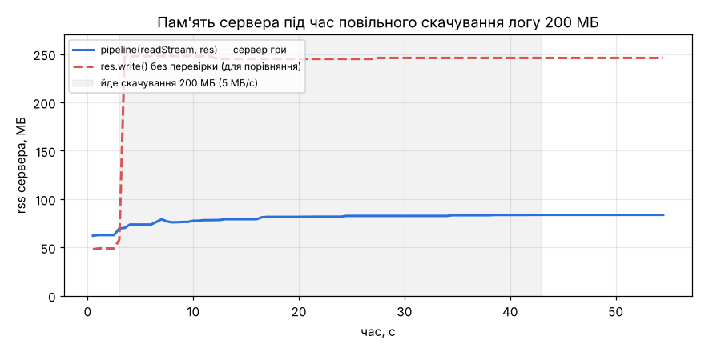
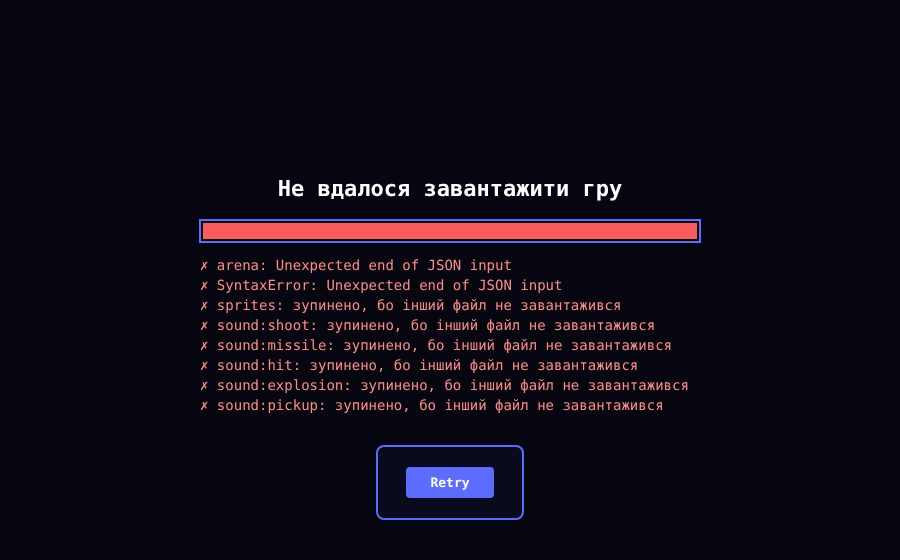

# Space Duel



Браузерна гра про космічні кораблі (курс JavaScript, лаби по тегах `lab-01` ... `lab-05`). Зліва і справа — два окремі вікна в одній кімнаті, штучна мережа 100±30 мс і 2% втрат (20 с, кораблями керував скрипт, запис з headless Chrome).

## Запуск

Три npm workspaces: `client/` (Vite), `server/` (Node) і `shared/` (симуляція і протокол, які імпортують обидва).

```bash
npm install
npm run dev:server   # термінал 1: Node-сервер на :3000 (API, WebSocket, гра)
npm run dev:client   # термінал 2: Vite на :5173, /api і /ws проксує на :3000
```

Відкрити `http://localhost:5173` у двох вікнах (друге можна в режимі інкогніто) і зайти в одну кімнату.

Як у продакшні (сервер сам віддає зібраний клієнт):

```bash
npm run build
npm start            # http://127.0.0.1:3000
```

Тести (`shared` + `server`): `npm test`. Лінтер і форматування: `npm run lint`, `npm run format:check`.

Налаштування сервера — у `server/.env` (`PORT`, `HOST`, `LOG_DIR`, `STATIC_DIR`, необов'язково `MAX_ROOMS`, `MAX_PLAYERS`). Їх перевіряє `server/src/config.js`: наприклад, з `PORT=abc` сервер не стартує і пише `[config] PORT має бути цілим числом від 1 до 65535, а зараз "abc"`.

Керування: `W`/`↑` газ, `A`/`D` або `←`/`→` поворот, `S`/`↓` розворот на 180°, `Space` постріл, `E` самонавідна ракета, `M` звук, `Esc` під час завантаження — скасувати. Чат: клікнути в поле, `Enter` — надіслати.

Netgraph (лаба 5): `P` — прогноз вкл/викл, `[` / `]` — затримка інтерполяції −/+ 17 мс, `N` — штучна мережа (вимк. → 100±30 мс 2% → 150±30 мс 5% → 100 мс 0%), `B` — зламати детермінізм (`Math.random()` в `integrate`, лише на клієнті).

Параметри в адресі:

- `/?codec=json` — input і знімки текстом JSON замість бінарного формату (лаба 5)
- `/?lag=100&jitter=30&drop=2` — штучна мережа одразу при вході: мс туди-назад, ± мс, % втрат (лаба 5)
- `/?seq=1`, `/?delay=200` — послідовне завантаження і штучна затримка (лаба 3, тільки через Vite)
- `/?fail=404`, `timeout`, `abort`, `json`, `flaky`, `lobby` — симуляція збоїв (лаба 3, тільки через Vite)
- `?exp=1..3` (лаба 1) і `?bug=this` (лаба 2) працювали в локальній грі; з лаби 5 гру рахує сервер, тому їх видно на тегах `lab-01`…`lab-04`

## Лаба 5: сервер рахує гру

### Як влаштовано

- **`shared/`** — те, що однаково виконується в браузері й у Node: `sim/` (World, Ship, Bullet, Asteroid, Pickup, зіткнення, homing), `rng.js` (mulberry32), `protocol.js` (типи, прапорці, `isValidInput`, `entityToRecord`), `codec/binary.js` і `codec/json.js`. Жодного DOM чи `node:`-модулів. Перевірено двома способами: тести імпортують симуляцію в Node, а `tsc` з `lib: es2023` (без DOM) не знаходить у `shared/src` жодного невідомого імені.
- **Детермінізм.** Немає `Math.random()` і `Date.now()`: усі «випадкові» числа (позиції астероїдів, бонуси, уламки) беруться з `world.rng = mulberry32(seed)`, а seed сервер надсилає в `joined`. Крок фіксований: `DT = 1/30`. Кулдауни пострілів рахуються в кроках (цілі числа), а не в секундах. Форма астероїда тепер не дані, а функція від його id (теж mulberry32), тому її не треба передавати.
- **Сервер** (`server/src/match.js`): у кожної кімнати свій `Match` з одним `World`. Крок запускається не через `setInterval`, а на абсолютний час: `nextTickAt += 33.33; setTimeout(step, nextTickAt - performance.now())`. Якщо крок відстав більш ніж на 33 мс, відлік починається заново, без пачки кроків підряд. За крок: застосувати всі input, що прийшли (відсортовані за `seq`, старі пропускаються), `world.step(DT)`, розіслати знімок і події.
- **Клієнт шле лише input** `{ seq, turn, thrust, fire, missile, flip }`, по одному за крок (30/с). Сервер перевіряє кожен (`turn` тільки -1/0/1, інакше закриває з 4000: перевірив, `turn = 5` → `4000 bad input values`). Окремий token bucket на input: 45 у запасі, +35/с.
- **Один input — один крок корабля і на сервері, і в прогнозі.** І `Ship.applyInput` на сервері, і клієнт викликають ту саму чисту функцію `stepShip(state, input)`. Тому прогноз збігається із сервером, поки не втрутиться те, чого клієнт не знає (зіткнення, втрачений пакет).
- **Знімок** (кожен крок) містить `tick`, `lastProcessedSeq` саме цього клієнта і всі сутності. Події, що не є станом (постріл, влучання, вибух, очки), ідуть окремим JSON-повідомленням `events`: з них клієнт грає звук, малює вибухи і рахує очки.

**Прогноз і звірка** (`client/src/net/netclient.js`):

1. Кожен крок клієнт шле input, кладе його в `pending` і одразу рухає свій корабель через `stepShip`.
2. Коли приходить знімок, клієнт викидає з `pending` усе, що `<= lastProcessedSeq`, бере стан свого корабля із сервера і заново програє решту `pending`.
3. Різницю між старим прогнозом і новим (поправку) він не показує стрибком. Корабель одразу ставиться в правильне місце, а на екрані додається зсув на мінус поправку, який згасає експоненційно (τ = 35 мс, тобто за ~100 мс лишається 5%). Поправки понад 150 px (респаун) застосовуються одразу.
4. **Свої кулі** з'являються одразу. Кожна має `shotId = (seq * 4 + номер) & 0xffff`, той самий номер ставить і сервер. Коли куля сервера з таким `shotId` з'являється в знімку, локальна стає «підтвердженою». Коли зникає (у щось влучила) — локальна теж зникає. Якщо сервер її так і не створив за RTT + 300 мс, вона зникає. Ракети не прогнозуються, бо наводяться самі.
5. **Чужі** (кораблі, кулі, астероїди, бонуси) малюються на `interpDelay` мс у минулому: знаходимо два знімки навколо часу `зараз + зсув годинника − interpDelay` і інтерполюємо (з урахуванням загортання країв і кута через ±π). Сутність є лише в новішому знімку — малюємо як є (щойно з'явилась). Є лише в старшому — не малюємо (зникла). Знімки, старші за вже отриманий, відкидаються.

**Штучна мережа** (`server/src/netsim.js`): на кожне з'єднання `{ lag, jitter, drop }`, ставиться з адреси або клавішею `N` на льоту (повідомлення `netsim`). Кожен бік отримує половину затримки і розкиду, тож RTT ≈ `lag`. Губляться лише input і знімки (2% = кожен 50-й), чат і події — ні. RTT клієнт міряє своїм `ping { t }` / `pong { t }`, які теж проходять через затримку.

**Netgraph** (правий верхній кут): RTT, вік останнього знімка, КБ/с вхід/вихід, input у черзі (не підтверджені), поправка (остання і максимум за 1 с) і графік поправок за 3 с, затримка інтерполяції, прогноз, мережа, кодек.

### Бінарний формат

Специфікація — коментар на початку `shared/src/codec/binary.js`. Коротко: **little-endian скрізь**, перший байт — версія (1), другий — тип.

- input — 8 байт: версія, тип, `seq` (Uint32), `turn` (Int8), кнопки (біти).
- знімок — 12 байт заголовка (версія, тип, `tick` Uint32, `lastProcessedSeq` Uint32, кількість Uint16) + **26 байт на сутність**: id Uint16, kind Uint8, flags Uint8, owner Uint16, x/y/vx/vy Float32, кут Int16 у тисячних радіана, extra Uint16.

Кут як Int16 дає точність 0.001 рад (0.057°). На 400 px це зсув до 0.2 px — менше пікселя, тож для малювання цього досить. Для прогнозу похибка кута теж нічого не ламає, бо стан звіряється з кожним знімком (поправки в середньому 0.07 px, нижче). Швидкість лишив Float32, бо вона потрібна для звірки свого корабля. Кулдауни корабля передаються в owner (2 байти), щоб прогноз знав, коли можна знову стріляти.

Знімок для всіх гравців однаковий, крім `lastProcessedSeq`, тому сервер кодує його один раз, а кожному робить копію і переписує 4 байти (`withAck`). Round-trip тести — `shared/test/codec.test.js` (`decode(encode(x))` у межах квантування, чужа версія, обрізаний пакет, `Buffer` із зсувом від `ws`).

| Кодек               | Байт/знімок | КБ/с на клієнта (вниз) | КБ/с на клієнта (вгору) | Encode+decode, мкс |
| ------------------- | ----------- | ---------------------- | ----------------------- | ------------------ |
| JSON                | 4823        | 141.8                  | 2.84                    | 34.5–46.9          |
| Binary (`DataView`) | 711         | 21.5                   | 0.24                    | 3.4–3.8            |

Як міряв: 4 боти (Node + `ws` + той самий `shared/codec`) в кімнаті «Мисливці», кожен шле input 30/с, 10 с, рахуємо байти на боці бота. На арені було ~27–32 сутності (астероїди, уламки, кулі). «Вниз» включає ще й JSON-події (постріли, вибухи), вони однакові для обох кодеків. Encode+decode — 20 000 разів на одному реальному знімку (30–32 сутності), Node 22. Бінарний знімок у ~6.8 раза менший і кодується в ~10 разів швидше. Input: 8 байт проти ~95 байт JSON.

### Запис про мережу

**Три проблеми і що з ними зроблено.**

1. _Затримка._ Між натисканням і реакцією сервера проходить RTT. Виміряв у Chrome при штучних 100 мс (без розкиду): від `keydown` до того, як мій корабель на екрані зрушив, **без прогнозу — 94–95 мс** (раз 61, раз 190: залежить від того, коли прийшов знімок), **з прогнозом — 26–30 мс**. Це просто найближчий крок клієнта, 33 мс. Із прогнозом корабель відчувається «своїм», без нього — «ватним».
2. _Розбіжність стану._ Якщо кожен клієнт рахує свій світ, через різні пакети й округлення вони за кілька секунд розходяться. Тут правда одна: світ рахує тільки сервер, клієнт лише прогнозує свій корабель тим самим кодом і кожен знімок звіряється. Хеш стану корабля після 1000 кроків однаковий у Node і в Chrome: `62305ba3` (`shared/src/scripted.js`).
3. _Чіти._ Клієнт не надсилає ні координат, ні влучань, тільки кнопки. Зіткнення, шкоду й очки рахує сервер. Підробити можна хіба що кнопки, а їх сервер перевіряє (`turn = 5` → закриття 4000) і обмежує за частотою (більше ~35 input/с → 4004, тож «прискорити» корабель частішими input не вийде).

**Netgraph до і після прогнозу.** Без прогнозу (`P`) корабель рухається, лише коли прийшов знімок, тому видно затримку ≈ RTT. З прогнозом у вільному космосі при 100±30 мс і 2% втрат за 15 с польоту (445 знімків): поправка в середньому **0.066 px**, медіана 0.001 px, максимум 3.99 px. Помітні поправки (> 1 px) були 11 разів. Це якраз загублені input (2%): сервер не зробив крок, який клієнт уже спрогнозував. Крихітні 0.001 px — це Float32 у знімку і кут Int16. Великі сплески — зіткнення з астероїдом, якого клієнт не прогнозує.

**Баг детермінізму (навмисний).** `B` вмикає в `integrate` рядок `vx += (Math.random() - 0.5) * 30`, тільки на клієнті. Сервер отримує інші числа, і прогноз розходиться на кожному кроці. За 10 с (303 знімки): середня поправка **1.59 px** (у 24 рази більше), медіана 1.24 px, максимум 7.38 px, більше 1 px — у 173 знімках із 303. На графіку netgraph замість рівної лінії видно стовпчики на кожен знімок. Прибрав (`B` ще раз) — поправки знову ~0. Тест `shared/test/sim.test.js` перевіряє і це: з `Math.random()` два однакові прогони дають різні хеші.

**Затримка інтерполяції.** Чим менша, тим ближче до правди бачиш суперників. Але якщо знімок запізнився або загубився, двох знімків навколо `renderTime` немає, і чужі завмирають до наступного. Виміряв частку кадрів без «свіжої пари» за 10 с при 100±30 мс і 2% втрат:

| interpDelay            | 0     | 33 мс | 66 мс | 100 мс | 133 мс |
| ---------------------- | ----- | ----- | ----- | ------ | ------ |
| кадри без пари знімків | 92.3% | 17.5% | 0.2%  | 0%     | 0%     |

66 мс (2 кроки) майже вистачає, але загублені два знімки підряд дають рідкі ривки. Обрав **100 мс (3 кроки)**: запас на один втрачений знімок плюс розкид. Ціна: суперників бачу на ~100 мс + RTT/2 у минулому. Через це для чесних влучань по кораблях потрібна lag compensation (сервер перевіряє постріл у стані, який бачив стрілець), її тут ще немає.

**Таймер сервера.** `/api/stats` з 4 гравцями: крок рахується в середньому 0.21 мс (максимум 0.41), інтервал між кроками в середньому 33.33 мс, максимум 34.93, розкид 0.63 мс, пропущених кроків 0. Для порівняння окремий скрипт за 5 с: `setInterval(…, 33)` дав середній інтервал 33.15 мс і «втік» на −27.7 мс (бо 33 ≠ 33.33), а схема з абсолютним часом — 33.33 мс і −0.8 мс.

## Лаба 4: Node.js, потоки, WebSocket

### Структура сервера

```text
server/
  .env                  # налаштування для розробки
  src/
    index.js            # node:http: API, статика, /health, вимкнення по SIGINT/SIGTERM
    config.js           # читає й перевіряє process.env
    static.js           # віддає client/dist: MIME, кеш, захист від ../
    protocol.js         # протокол v0, validate(), коди закриття
    rooms.js            # Room extends EventEmitter, RoomManager
    ws.js               # WebSocket: join за 5 с, ping, token bucket, повільні клієнти
    log/matchlog.js     # Transform (події -> NDJSON) + pipeline у файл
    log/replay.js       # читання логу рядок за рядком (async-генератор)
  scripts/              # make-big-log, replay, watch-rss, no-backpressure-demo
  test/                 # node:test
```

На клієнті: `client/src/net/connection.js` (обгортка сокета) і `client/src/lobby/chatView.js` (чат). Лобі з лаби 3 тепер бере кімнати з `GET /api/rooms` і вміє створювати нові через `POST /api/rooms`.

### HTTP

| Запит                                  | Що робить                                                                                                      |
| -------------------------------------- | -------------------------------------------------------------------------------------------------------------- |
| `GET /health`                          | `{ ok, uptime, rooms, connections, rssMb }`                                                                    |
| `GET /api/rooms`                       | список кімнат                                                                                                  |
| `POST /api/rooms`                      | `{ name, maxPlayers }` → нова кімната (тіло не більше 1 КБ, name 1–24 символи, maxPlayers 2–8; інакше 400/413) |
| `GET /api/replays`                     | список логів матчів                                                                                            |
| `GET /api/replays/:id`                 | файл логу потоком (`pipeline(readStream, res)`)                                                                |
| `GET /api/replays/:id/events?limit=20` | перші N подій, розібрані через `readEvents`                                                                    |
| `GET /api/slow?ms=300`                 | демо: займає цикл подій на ms мілісекунд                                                                       |
| `GET /api/stats`                       | (лаба 5) тривалість і розкид кроків кожного матчу, байти кожного клієнта                                       |
| все інше                               | файли з `client/dist`, шляхи з `..` і `%00` → 400, невідомий шлях → `index.html`                               |

Вимкнення: на `SIGINT`/`SIGTERM` сервер перестає приймати з'єднання, закриває всі сокети з кодом 1001, чекає, поки `pipeline` дозапише логи, і виходить з кодом 0. Якщо за 5 с не вийшло — виходить примусово з кодом 1. Перевірив: і `SIGINT`, і `SIGTERM` дають код 0.

### Протокол v0 і обмеження

Кожне повідомлення — JSON з `v: 0` і `type`. Клієнт шле `join { room, name }`, `chat { text }`, `leave`. Сервер шле `joined`, `roster { players }`, `chat { from, text, t }`, `error { code, message }`.

| Що                               | Значення                                                                        | Що робить сервер                    |
| -------------------------------- | ------------------------------------------------------------------------------- | ----------------------------------- |
| не JSON / не та форма            | —                                                                               | закриває з кодом **4000**           |
| невідомий `type`                 | —                                                                               | **4001**                            |
| `v` не 0                         | —                                                                               | **4002**                            |
| не прислав `join`                | 5 с                                                                             | **4003**                            |
| забагато повідомлень             | token bucket: 10 у запасі, +5 за секунду (з лаби 5 для input окреме: 45, +35/с) | **4004**                            |
| кімнати немає або повна          | 8 гравців у кімнаті, 20 кімнат на сервер                                        | **4005**                            |
| повідомлення більше `maxPayload` | 2048 байт                                                                       | бібліотека `ws` закриває з **1009** |
| `bufferedAmount` клієнта         | > 64 КБ — чат йому не шлемо; > 1 МБ                                             | **4006**                            |
| не відповідає на ping            | ping кожні 15 с, 2 пропущені pong                                               | `terminate()`                       |
| довжина чату / імені             | 200 / 16 символів                                                               | 4000                                |

`roster` вважається важливим і йде навіть повільному клієнту, а чат можна пропустити. Кожен сокет має обробник `'error'`.

Клієнтський `Connection` (extends EventTarget) розсилає повідомлення сервера як події за їхнім `type`. Поки немає з'єднання, `send()` складає повідомлення в чергу (до 50) і відправляє після `open`. Після обриву підключається знову через 0.5, 1, 2, 4... с (максимум 10 с) + випадкові 0–300 мс, і при кожному підключенні знову шле `join`. На кодах 1000 і 4000–4005 не перепідключається, бо сервер закрив нас за нашу ж помилку. Перевірив у Chrome: вбив сервер, клієнт показує «з'єднання втрачено, чекаю (код 1006)», повідомлення, написане в цей час, пішло після перезапуску.

### Лог матчу

Кожна кімната пише лог у `LOG_DIR/<кімната>-<час>.ndjson`. Матч починається з першим гравцем і закінчується, коли кімната спорожніла:

```js
const events = on(room, 'event', { close: ['empty', 'closed'] });
pipeline(Readable.from(roomEvents()), new NdjsonTransform(), createWriteStream(file));
```

`NdjsonTransform` — Transform з `writableObjectMode: true`: на вхід об'єкт `{ t, room, type, ... }`, на вихід рядок `JSON + '\n'`. Приклад:

```text
{"t":1795709354310,"room":"hunters","type":"join","player":1,"name":"Tester"}
{"t":1795709354408,"room":"hunters","type":"chat","player":1,"text":"останнє слово"}
{"t":1795709354879,"room":"hunters","type":"leave","player":1,"name":"Tester"}
```

Повтор: `GET /api/replays/:id` віддає файл через `pipeline(createReadStream(file), res)`, а `readEvents(file)` (async-генератор поверх `createReadStream` + `readline`) читає його подію за подією. В обох випадках файл ніколи не читається в пам'ять цілком.

### Пам'ять при повільному скачуванні (backpressure)

Згенерував лог на 200 МБ (`npm run make-big-log --workspace=server`) і качав його з обмеженням 5 МБ/с (`curl --limit-rate 5M`, те саме, що throttling у DevTools). Скрипт `scripts/watch-rss.js` кожні 500 мс брав `rss` із `/health`. Для порівняння той самий файл віддавав `scripts/no-backpressure-demo.js`, де `res.write()` викликається, а його результат ігнорується.



|                                          | rss до | rss під час скачування (40 с)       |
| ---------------------------------------- | ------ | ----------------------------------- |
| `pipeline(readStream, res)` (сервер гри) | 62 МБ  | 62–84 МБ, рівна лінія               |
| `res.write()` без перевірки              | 48 МБ  | одразу 248 МБ — весь файл у пам'яті |

Сирі дані: `docs/rss-pipeline.csv`, `docs/rss-no-backpressure.csv`.

Чому так. Файл читається швидко (диск), а клієнт приймає повільно (5 МБ/с). Коли внутрішній буфер `res` більший за `highWaterMark`, `write()` повертає `false`: «зачекай». `pipeline` на це ставить потік файлу на паузу і продовжує читати після події `'drain'`, тому в пам'яті одночасно лише кілька шматків по 64 КБ. Неправильна версія `false` не слухає, і за секунду весь файл опиняється в буфері сокета.

Де ще в лабі є backpressure: запис логу матчу (`pipeline` у `matchlog.js`), генерація великого логу (генератор віддає подію лише тоді, коли файл встигає записати), і WebSocket, де аналог — `bufferedAmount`. Там сервер сам вирішує: неважливе (чат) не шле, а занадто повільного клієнта закриває з 4006.

### Цикл подій і блокування

Цикл подій Node (libuv) іде по фазах: **timers** (`setTimeout`/`setInterval`) → **pending callbacks** → **poll** (нові з'єднання, дані з сокетів, файли) → **check** (`setImmediate`) → **close callbacks**. Між колбеками виконуються `process.nextTick` і мікрозадачі промісів. Весь мій JavaScript — в одному потоці.

Демо: клієнт кожні 250 мс шле повідомлення в чат і міряє, за скільки воно повертається. Через 3 с інший клієнт починає безперервно смикати `GET /api/slow?ms=300`, де стоїть синхронний цикл на 300 мс:

|                        | повідомлень | медіана | максимум |
| ---------------------- | ----------- | ------- | -------- |
| без навантаження       | 11          | 1 мс    | 1 мс     |
| поки йдуть `/api/slow` | 12          | 160 мс  | 269 мс   |

Поки обробник `/api/slow` крутить `while`, Node не може дійти до фази poll, тому дані від WebSocket лежать у ядрі непрочитаними. Чат усіх гравців чекає до 300 мс, так само `/health`, heartbeat і запис логів. Async тут не допоможе, бо це один потік. Треба не блокувати: розбити роботу на шматки або винести в `worker_threads` (лаба 7).

### Чому "error" без слухача валить процес

`EventEmitter` вважає подію `'error'` особливою: якщо на неї ніхто не підписаний, `emit('error')` просто кидає помилку, і вона летить до самого верху. Це зроблено навмисно, щоб помилки не губились мовчки. Але для сервера це означає, що одна помилка одного сокета чи потоку вбиває його для всіх гравців.

Реальний випадок у моєму сервері: запустив другу копію, коли порт 3000 був зайнятий:

```text
node:events:497
      throw er; // Unhandled 'error' event
      ^

Error: listen EADDRINUSE: address already in use 127.0.0.1:3000
    at Server.setupListenHandle [as _listen2] (node:net:1941:16)
    ...
Emitted 'error' event on WebSocketServer instance at:
    at Server.emit (node:events:519:28)
```

Тут цікаво, що помилку кинув не `http.Server`, а `WebSocketServer`: `ws` пересилає помилки http-сервера на себе. Фікс — обробник на обох:

```js
server.on('error', onServerError);
ws.wss.on('error', onServerError);
```

Тепер замість стека: `[http] порт 3000 уже зайнятий. Закрий інший сервер або зміни PORT у .env` і вихід з кодом 1. Так само `socket.on('error', ...)` стоїть на кожному WebSocket: наприклад, повідомлення більше 2048 байт дає в `ws` помилку `Max payload size exceeded`, і без обробника вона звалила б сервер.

З промісами те саме: `async function save() { throw ... }; save();` без `.catch` — у Node (з версії 15) це unhandled rejection, процес падає з кодом 1. Тому в `index.js` у кожного запиту є `route(req, res).catch(...)`, який відповідає 500 і пише лог, а сервер живе далі.

## Лаба 3: асинхронний JavaScript

> Розділи лаб 1–3 описують стан на їхніх тегах. З лаби 5 симуляція переїхала в `shared/src/sim/`, `World` більше не `EventTarget` (події складаються в `world.events` і приходять від сервера), а вибухи малює клієнт.

### Що де

- `client/public/assets/manifest.json` — що завантажувати: спрайтшит, 5 звуків, `arena.json`
- `client/src/assets/loader.js` — `fetchJson` (перевіряє `response.ok`), `loadJson`, `loadImage`, `loadAudio`, `withRetry`, `loadAll`. Усі приймають `signal`
- `client/src/audio.js` — `AudioContext`, вмикається після першого кліку або клавіші; звуки декодуються ще під час завантаження
- `client/src/hud.js` — рахунок і написи `+100`
- `client/src/lobby/lobby.js` — `class Lobby extends EventTarget` (`start`, `refresh`, `join`, `stop`); `client/src/lobby/lobbyView.js` — тільки DOM
- `GET /api/rooms` — список кімнат (у лабі 3 був статичний `public/api/rooms.json`, з лаби 4 його віддає сервер)
- `client/dev/devMiddleware.js` — middleware для Vite (працює лише в `npm run dev:client`): `?delay=мс` і `?flaky=N` (перші N запитів отримують 503)

Порядок у `client/src/main.js`: екран завантаження з прогрес-баром → `await loadAll(...)` → лобі → гравець натискає Join → гра. Кнопку Join чекаємо як проміс: `new Promise(resolve => lobby.addEventListener('join', ..., { once: true }))`.

**Повтори.** `withRetry` робить до 3 спроб, пауза `200 · 2^(n-1)` мс плюс випадкові 0–200 мс (jitter). Повторює лише 5xx, таймаут і помилку мережі. 4xx, битий JSON і скасування гравцем не повторює, бо повтор не допоможе. Кожна спроба має свій таймаут `AbortSignal.timeout`, об'єднаний із загальним сигналом через `AbortSignal.any`.

**Прогрес.** Кожен файл у `loadAll` обгорнутий у `.then`/`.catch`, який збільшує лічильник і викликає `onProgress(done, total)`. Тому смужка рухається по мірі готовності файлів, а не одразу на 100%.

**Необов'язкові файли.** Спрайтшит і звуки позначені `optional`: якщо вони не завантажились, гра стартує з фігурами замість спрайтів або без звуку. `arena.json` обов'язковий: без нього показується кнопка Retry.

**Події замість імпортів.** `World extends EventTarget` і в потрібних місцях робить `dispatchEvent(new CustomEvent(...))`: `fired`, `hit`, `exploded`, `pickup`, `score`. У папці `shared/src/sim/` немає жодного імпорту `audio.js` чи `hud.js`, вони самі підписуються на події світу в `client/src/game.js`.

**Лобі.** `refresh()` викликається одразу і далі кожні 3 с через `setInterval`. Кожен запит має `AbortSignal.timeout(2000)`, а сигнал контролера лобі скасовує все, щойно гравець натиснув Join (`stop()` → `abort()`), тож запити не висять у фоні.

**Спрайти.** `client/public/assets/sprites.png` — один рядок кадрів 64×64 (корабель, корабель з вогнем, куля, ракета, астероїди, мисливці, бонуси). Малюються через `drawImage(img, sx, 0, 64, 64, ...)`, де `sx = номер_кадру * 64`.

### Sequential vs concurrent

Заміряв `performance.now()` усередині `loadAll` (7 файлів: arena.json, sprites.png, 5 wav, разом із декодуванням звуку). Headless Chrome, локальний сервер з тим самим middleware, по 3 запуски:

| Режим                        | Без затримки | `?delay=200` (кожна відповідь +200 мс) |
| ---------------------------- | ------------ | -------------------------------------- |
| concurrent (`Promise.all`)   | 26–28 мс     | 415–420 мс                             |
| sequential (`for` + `await`) | 30–35 мс     | 1447–1448 мс                           |

Без затримки різниця маленька, бо локально файли віддаються майже миттєво. Із затримкою послідовне завантаження — це сума: 7 × 200 = 1400 мс + декодування. Паралельне мало б дати ~200 мс, а вийшло ~415. Так вийшло через те, що браузер по HTTP/1.1 тримає максимум 6 з'єднань на один сервер: 6 файлів ідуть разом, а сьомий чекає, тобто 2 × 200 мс. Все одно паралельне завантаження у 3.5 раза швидше.

### П'ять головоломок порядку

Перевірено в Chrome (кожну запускав 10 разів, вивід нижче — реальний).

**1. await**

```js
console.log('A');
async function f() {
  console.log('B');
  await null;
  console.log('C');
}
f();
Promise.resolve().then(() => console.log('D'));
console.log('E');
```

Вивід: `A B E C D`. До першого `await` функція виконується синхронно (B), продовження після `await` стає мікрозадачею раніше, ніж `.then` з D.

**2. setTimeout всередині .then**

```js
setTimeout(() => console.log('1'), 0);
Promise.resolve().then(() => {
  console.log('2');
  setTimeout(() => console.log('3'), 0);
});
queueMicrotask(() => console.log('4'));
console.log('5');
```

Вивід: `5 2 4 1 3`. Спочатку синхронний код, потім усі мікрозадачі (2, 4), потім задачі-таймери по черзі: таймер 1 поставлений раніше за таймер 3.

**3. requestAnimationFrame**

```js
requestAnimationFrame(() => {
  console.log('raf');
  Promise.resolve().then(() => console.log('raf-micro'));
});
setTimeout(() => console.log('timeout'), 0);
Promise.resolve().then(() => console.log('micro'));
console.log('sync');
```

Вивід: `sync micro timeout raf raf-micro`, але іноді `sync micro raf raf-micro timeout`. rAF — не задача і не мікрозадача, він виконується перед малюванням кадру, а коли буде кадр, залежить від того, де ми в циклі монітора. Стабільно одне: `raf-micro` завжди одразу після `raf`, бо мікрозадачі вичерпуються після кожного колбека.

**4. Повернути проміс з .then**

```js
Promise.resolve()
  .then(() => {
    console.log('a1');
    return Promise.resolve();
  })
  .then(() => console.log('a2'));
Promise.resolve()
  .then(() => console.log('b1'))
  .then(() => console.log('b2'))
  .then(() => console.log('b3'))
  .then(() => console.log('b4'));
```

Вивід: `a1 b1 b2 b3 a2 b4`. Якщо `.then` повертає проміс, наступний `.then` чекає, поки цей проміс "розпакується", а це +2 мікрозадачі. Тому a2 відстає від b2 на два кроки.

**5. Помилка, catch, finally**

```js
async function load() {
  console.log('L1');
  throw new Error('x');
}
load()
  .catch(() => console.log('L2'))
  .finally(() => console.log('L3'));
setTimeout(() => console.log('L4'));
(async () => {
  console.log('L5');
  await undefined;
  console.log('L6');
})();
console.log('L7');
```

Вивід: `L1 L5 L7 L2 L6 L3 L4`. `throw` в async-функції не ламає код одразу, а робить проміс rejected. `catch` (L2) і продовження IIFE (L6) — дві мікрозадачі в черзі. `finally` ставиться в чергу тільки після L2, тому L3 після L6. Таймер L4 — останній.

### Галерея збоїв

| Збій                | Як відтворити                                                                       | Що відбувається                                                                                                                                                                |
| ------------------- | ----------------------------------------------------------------------------------- | ------------------------------------------------------------------------------------------------------------------------------------------------------------------------------ |
| 404 спрайтшита      | `?fail=404`                                                                         | `HttpError 404`, без повторів (4xx). Спрайти необов'язкові, тому гра стартує і малює кораблі фігурами, на HUD напис про це. В консолі `[loader] sprites пропущено: HTTP 404`   |
| Таймаут мережі      | `?fail=timeout` (arena.json відповідає за 3 с, таймаут 1 с)                         | 3 спроби з паузами (в консолі `[retry] спроба 1 невдала (signal timed out), ще раз через 217 мс` і т.д.), потім `TimeoutError` і кнопка Retry                                  |
| Abort посередині    | `?fail=abort` (усе повільне, через 0.5 с `abort()`), або `Esc` під час завантаження | усі файли отримують `AbortError`, повторів немає, кнопка Retry                                                                                                                 |
| Битий JSON          | `?fail=json` (`broken.json` обрізаний)                                              | `SyntaxError: Unexpected end of JSON input`, без повторів. Інші файли, що ще качались, скасовуються (`Promise.all` сам їх не зупиняє, тому `controller.abort()`), кнопка Retry |
| Нестабільний сервер | `?fail=flaky`                                                                       | два рази 503, ретраї з backoff, на третій раз успіх, гра стартує (~820 мс замість ~25)                                                                                         |
| Таймаут лобі        | `?fail=lobby`                                                                       | у лобі червоний напис `Не вдалося оновити список: signal timed out`, лобі пробує знову кожні 3 с                                                                               |

Retry у демо запускає завантаження ще раз уже без симуляції збою, тож друга спроба проходить і з'являється лобі.

Скріншоти: `docs/failures/404-sprite.png`, `timeout.png`, `abort.png`, `bad-json.png`, `lobby-timeout.png`.





## Лаба 2: об'єкти, класи і this

### Структура

- `shared/src/sim/vector.js` — `Vector2`, усі методи повертають новий вектор (`add`, `sub`, `scale`, `length`, `normalize`, `rotate`, `dot`, `fromAngle`)
- `shared/src/sim/entity.js` — `Entity`: `id` (приватний `#id` зі статичного лічильника `static #nextId`), `pos`, `vel`, `angle`, `radius`, `kind`, `alive`, `update(dt)`
- `Ship`, `Bullet`, `Asteroid`, `Pickup`, `Explosion` — кожен `extends Entity`, глибше нікого немає
- `shared/src/sim/world.js` — `World` поверх `Map<id, Entity>`: `spawn`, `despawn` (лише позначка, видалення в `#sweep()` в кінці кроку), `get`, `[Symbol.iterator]`, генератор `*ofKind(kind)`, `step(dt, inputs)`
- `shared/src/sim/collision.js` — `findCollisions(world)`: коло-коло, кожен з кожним, повертає пари `[a, b]`
- `shared/src/sim/rules.js` — що робити з парою: куля б'є астероїд або чужий корабель, корабель врізається в астероїд, корабель підбирає бонус
- `shared/src/sim/components/homing.js` — компонент самонаведення і `homingSystem`

Порядок кроку в `World.step`: зберегти попередні позиції → роздати кораблям керування → самонаведення → `update` усіх → загорнути позиції → зіткнення → нові астероїди і бонуси → `#sweep()`.

Нові сутності, створені під час кроку (кулі, уламки, вибухи), теж додаються в Map тільки в `#sweep()`. Інакше `for...of` по Map пройшов би і по них у тому ж кроці.

У корабля приватне `#hp`, ззовні є лише `get hp()`. Спроба `ship.hp = 5` у модулі кидає `TypeError`, бо сетера немає. Здоров'я змінюється тільки через `takeDamage()`. Після знищення корабель 2 с чекає, з'являється у вільному місці з 2 с щита. Рахунок, хвиля, hp і бонуси видно на HUD.

### Баг з this

Постріл зроблений методом `Ship.fire()`, який ставить `this.shotQueued = true`, а куля створюється в `update()`. Спочатку слухач був підключений так (зараз цей варіант вмикається через `?bug=this`):

```js
window.addEventListener('keydown', ship.fire);
```

`this` залежить від того, як функцію викликали, а не де її оголосили. Правила від сильнішого: `new` → новий об'єкт; `call`/`apply`/`bind` → переданий об'єкт; `obj.f()` → `obj`; звичайний `f()` → `undefined` (у модулях і класах завжди strict mode). Стрілки свого `this` не мають.

Помилки в консолі немає, але корабель не стріляє. `addEventListener` отримує саму функцію без об'єкта, а браузер викликає слухача з `this` = елемент, на якому висить слухач, тобто `window`. У підсумку записується `window.shotQueued = true` (у консолі видно `window.shotQueued === true`). Якщо так само викликати `const f = ship.fire; f()`, у модулі буде default binding, `this === undefined` і `TypeError`.

Що вибрав: стрілка-обгортка.

```js
window.addEventListener('keydown', (event) => {
  if (event.code === 'Space') ship.fire();
});
```

Тут `ship.fire()` викликається через крапку (implicit binding), тож `this === ship`. До того ж все одно треба перевіряти, яка це клавіша.

Інші варіанти:

- `ship.fire.bind(ship)` — нова функція з назавжди прив'язаним `this`. Мінус: щоб потім зробити `removeEventListener`, результат `bind` треба зберегти в змінну, бо кожен `bind` повертає нову функцію.
- поле-стрілка в класі `fire = () => { this.shotQueued = true; }` — `this` прив'язаний одразу при створенні. Мінус: функція створюється окремо для кожного корабля, а не одна на `Ship.prototype`, і її не можна нормально перевизначити через `super.fire()`.

### Композиція: homing і pickup

Якби робили все наслідуванням, вийшло б приблизно так:

```text
Entity
├── MovingEntity
│   ├── Ship
│   ├── Bullet
│   │   └── HomingBullet
│   └── Asteroid
│       └── HomingAsteroid
└── StaticEntity
    └── Pickup
        ├── ShieldPickup
        └── TriplePickup
```

Проблеми: логіка наведення потрібна і кулі, і астероїду, а вони в різних гілках, тому її довелося б копіювати або піднімати в `MovingEntity`, де вона більшості не потрібна. Кожна нова комбінація ("самонавідний бонус", "астероїд, який стріляє") означає новий клас. Дерево стає глибоким, а зміна в середньому класі зачіпає всіх нащадків.

Як зроблено в мене (явні поля-компоненти, варіант "explicit component fields"):

- **homing** — це просто дані `{ targetKind, turnRate, range }`, які можна покласти в поле будь-якої сутності. Ракета — це звичайний `Bullet`, якому зробили `missile.homing = makeHoming('asteroid', 4, 500)`. Астероїд-мисливець — звичайний `Asteroid` з `homing = makeHoming('ship', 0.8, 400)`. Повертає їх одна функція `homingSystem(world, dt)`, яка перевіряє лише `if (entity.homing)`, і їй неважливо, куля це чи астероїд.
- **pickup** — `Pickup extends Entity` без швидкості, але з компонентом-даними `pickup = { effect, duration }`. Правило зіткнень перевіряє `if (thing.pickup)`, а не клас, а корабель просто кладе ефект собі в `effects`. Новий бонус — це нове значення `effect`, а не новий клас.

Що вийшло: наслідування лише один рівень (`Entity` → конкретна сутність), а поведінки додаються полями. Мінус: системи мають самі перевіряти, чи є в сутності потрібне поле, і з тексту класу не видно, що в нього може з'явитись `homing`.

### Експерименти в консолі

| Код                                                         | Результат           | Чому                                                                                                         |
| ----------------------------------------------------------- | ------------------- | ------------------------------------------------------------------------------------------------------------ |
| `b = Object.create(a); a.hello = 'changed'; b.hello`        | `'changed'`         | у `b` немає свого `hello`, пошук іде по прототипу в `a`                                                      |
| `const m = a.m; m()` для `class A { m() { return this; } }` | `undefined`         | виклик без об'єкта, а класи завжди в strict mode. `m.call(a)` повертає `a`. Це той самий баг, що зі слухачем |
| `{ '1': 'x' }[1]` проти `new Map([[1, 'x']]).get('1')`      | `'x'` і `undefined` | ключі звичайного об'єкта завжди рядки, тому `1` стає `'1'`. Map порівнює ключі як є, а `1 !== '1'`           |

## Лаба 1: Event Loop і ігровий цикл

### Структура

- `client/src/loop.js` — `createLoop({ step, simulate, render })`: rAF, акумулятор, обмеження dt до 0.25 с, статистика для HUD
- `client/src/input.js` — `createInput(target)`: замикання зі станом клавіш, `isDown` і `justPressed`
- `shared/src/sim/ship.js` — `integrate(ship, input, dt)`: повертає новий стан, без DOM (у лабі 2 її викликає `Ship.update`)
- `shared/src/sim/arena.js` — загортання країв
- `client/src/render/canvas.js` — canvas з урахуванням `devicePixelRatio`
- `client/src/render/draw.js` — зірки, корабель, HUD, інтерполяція (з урахуванням переходу кута через ±π і переходу через край арени)

`justPressed` зроблений через лічильник натискань: на `keydown` лічильник збільшується, а в кінці кожного кроку запам'ятовується його значення. Якщо лічильник змінився з минулого кроку, було нове натискання. Так натискання не губиться, навіть якщо клавішу відпустили раніше, ніж відбувся крок.

### Налаштування фізики

| Параметр      | Значення  | Чому                                                                                                                     |
| ------------- | --------- | ------------------------------------------------------------------------------------------------------------------------ |
| `turnSpeed`   | 3.5 рад/с | повний оберт приблизно за 1.8 с; швидше важко прицілитись, повільніше корабель здається важким                           |
| `thrustPower` | 260 px/с² | до ~200 px/с розганяється приблизно за секунду                                                                           |
| `drag`        | 0.5 1/с   | при 0 корабель ніколи не зупиняється, при великому значенні не відчувається космос                                       |
| `maxSpeed`    | 380 px/с  | без обмеження швидкість росла б до 520 px/с (тяга / опір), і корабель перелітав би екран швидше, ніж встигаєш зреагувати |

Опір зроблений як `v *= Math.exp(-drag * dt)`. Так гальмування правильно масштабується від `dt`, на відміну від `v *= 0.99` за кадр.

### Експерименти

Монітор 144 Гц, Chrome. Звичайний режим: steps/s = 60, frames/s = 143, frame time = 7.0 ms (сам кадр рахується 0.2 ms).

#### 1. Блокування 100 мс кожен 60-й кадр (`?exp=1`)

Результат: frames/s ≈ 116 (було 143), максимальний dt за 10 с ≈ 107 ms, steps/s = 60.

Гравець бачить регулярні фризи: приблизно двічі на секунду картинка зупиняється на 0.1 с, потім корабель стрибає вперед. Steps/s залишається 60, бо після фризу акумулятор отримує ~0.1 с і за один кадр робить ~6 кроків симуляції.

Чому це не обійти з JS у тому ж потоці: JS однопотоковий, і функція виконується до кінця (run-to-completion). Поки `while` крутиться в call stack, event loop не може взяти наступну задачу, обробити keydown, виконати мікрозадачі чи дійти до кроку рендеру (style/layout/paint). `setTimeout`, проміси та інші обробники лише стають у чергу і чекають, тому перервати синхронний цикл вони не можуть. Допомогти може тільки інший потік (Web Worker) або менше роботи за кадр.

#### 2. `setInterval(frame, 16)` замість rAF (`?exp=2`)

|                                   | rAF                                                 | setInterval                            |
| --------------------------------- | --------------------------------------------------- | -------------------------------------- |
| frames/s                          | 143                                                 | ≈ 62                                   |
| dt min..max за 10 с, ms           | 5.9..20.7                                           | ≈ 14..19                               |
| jitter (станд. відхилення dt), ms | 0.59                                                | ≈ 1.2                                  |
| 5 с у фоновій вкладці             | кадрів немає взагалі, після повернення dt ≈ 5000 ms | ≈ 1 кадр/с, dt ≈ 1000 ms, steps/s ≈ 15 |

Висновки: `setInterval` ставить задачу в task queue приблизно раз на 16 мс, але ніяк не прив'язаний до оновлення екрана. Тому частота ~62 fps навіть на моніторі 144 Гц, кадри то пропускаються, то малюються двічі за одне оновлення, і dt «стрибає». rAF викликається рівно один раз перед кожним малюванням. У фоновій вкладці rAF повністю зупиняється, а `setInterval` продовжує працювати, але браузер обмежує його до ~1 разу на секунду. Через обмеження dt до 0.25 с за такий тік робиться лише 15 кроків, тому steps/s падає до ~15. Ще одна причина: 16 мс ≠ 16.67 мс.

#### 3. Змінний крок замість фіксованого (`?exp=3`)

Тест: натиснути `R`, потім тримати `W` 5 секунд (у лабі 2 на арені вже є астероїди, тому заміри зручніше робити на тезі `lab-01`). HUD показує «шлях за 5 с».

Ті самі розрахунки без браузера (`npm run exp3 --workspace=client`, та сама `integrate()`):

| Частота кадрів   | Змінний крок, px | Фіксований крок, px |
| ---------------- | ---------------- | ------------------- |
| 60 Гц            | 1508.04          | 1508.04             |
| 144 Гц           | 1507.68          | 1508.04             |
| ~10 fps (CPU 6×) | 1510.51          | 1508.04             |

У браузері (DevTools → Performance → CPU 6× slowdown):

|                              | Без тротлінгу | CPU 6×   |
| ---------------------------- | ------------- | -------- |
| `?exp=3` (змінний крок)      | ≈ 1507.7      | ≈ 1508.9 |
| звичайний режим (фіксований) | 1508.04       | 1508.04  |

Пояснення: інтегрування йде дискретними кроками, і результат залежить від розміру кроку. Якщо крок = час кадру, то на різних комп'ютерах і при різному навантаженні корабель опиняється в різних місцях. З фіксованим кроком завжди виконується 300 однакових кроків по 1/60 с, тому результат однаковий до сотих. Для мультиплеєра (лаба 5) це обов'язково: клієнт і сервер мають рахувати однаково.
